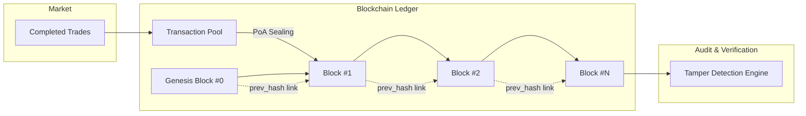

# SecureTwinGrid Modular Educational Blockchain

> [!IMPORTANT]
> **Research Prototype Notice**: This blockchain module is a research and educational prototype developed for MSc thesis digital twin simulation, microgrid audit logging, and cyber-physical security benchmarking. It does **NOT** implement cryptocurrency mining (Proof-of-Work), gas fees, or real monetary tokens. It uses a lightweight, deterministic Proof-of-Authority (PoA) validator model.

---

## 🏛️ Architecture Overview

The `blockchain/` module provides an immutable, tamper-evident distributed ledger designed to record completed peer-to-peer (P2P) electricity trades between prosumers and consumers in a smart microgrid.



---

## 📁 Module Structure

| File | Description |
| :--- | :--- |
| [`blockchain/block.py`](file:///c:/Users/Bhushan/OneDrive/Documents/Pract_MSc/rp_msc/SecureTwinGrid/blockchain/block.py) | `Block` data structure (`index`, `timestamp`, `transactions`, `previous_hash`, `nonce`, `hash`, `validator`). |
| [`blockchain/blockchain.py`](file:///c:/Users/Bhushan/OneDrive/Documents/Pract_MSc/rp_msc/SecureTwinGrid/blockchain/blockchain.py) | `Blockchain` coordinator: Genesis block minting, transaction pooling, PoA block creation, search, JSON persistence. |
| [`blockchain/transaction.py`](file:///c:/Users/Bhushan/OneDrive/Documents/Pract_MSc/rp_msc/SecureTwinGrid/blockchain/transaction.py) | `Transaction` data structure (`trade_id`, `seller_id`, `buyer_id`, `energy_kwh`, `price_per_kwh`, `total_value`, `timestamp`, `tx_hash`). |
| [`blockchain/hash_utils.py`](file:///c:/Users/Bhushan/OneDrive/Documents/Pract_MSc/rp_msc/SecureTwinGrid/blockchain/hash_utils.py) | Deterministic SHA-256 canonical hashing routines for blocks, transactions, and JSON payloads. |
| [`blockchain/validation.py`](file:///c:/Users/Bhushan/OneDrive/Documents/Pract_MSc/rp_msc/SecureTwinGrid/blockchain/validation.py) | `ValidationResult` and cryptographic audit routines (`validate_chain`, `detect_tampering`). |
| [`blockchain/tests/`](file:///c:/Users/Bhushan/OneDrive/Documents/Pract_MSc/rp_msc/SecureTwinGrid/blockchain/tests/test_blockchain.py) | Comprehensive pytest test suite for valid chains, tampered transactions, tampered blocks, and broken links. |

---

## 🔒 Cryptographic Properties

1. **SHA-256 Block Hashing**: Blocks deterministically hash their `index`, `timestamp`, serialized `transactions`, `previous_hash`, `nonce`, and `validator` identity.
2. **Previous-Hash Chaining**: Each block contains the exact 64-character SHA-256 digest of its ancestor, forming an unbroken cryptographic chain back to Genesis (`0000...0000`).
3. **Tamper Detection**: If any adversary modifies a committed trade's `energy_kwh`, `price_per_kwh`, `seller_id`, or `buyer_id`, the block's SHA-256 recomputation diverges immediately, and the chain audit fails with structured error diagnostics (`TRANSACTION_TAMPERED`, `BLOCK_HASH_MISMATCH`, `PREVIOUS_HASH_MISMATCH`).

---

## 🧪 Running Blockchain Tests

```bash
pytest blockchain/tests/
```
